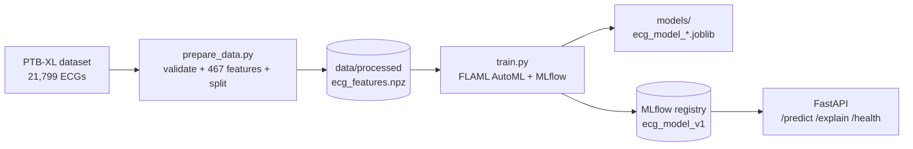

# ECG Anomaly Detection

[](https://github.com/jawad1569/ECGAnomaly/actions/workflows/ci.yml)

**Classify 12-lead ECGs into five diagnostic classes (NORM, MI, STTC, CD, HYP) with an AutoML-tuned model that is tracked in MLflow and served through a validated FastAPI endpoint.**

Milestone 1: Model & API. Docker, CI/CD and deployment are Milestone 2.

## Architecture



## Quick start

```bash
git clone https://github.com/jawad1569/ECGAnomaly.git
cd ECGAnomaly
make setup     # install dependencies (requirements-dev.txt; the API alone needs requirements.txt)
# download PTB-XL 1.0.3 (PhysioNet) and unzip it into dataset/
make data      # step 1: validate + build features
make train     # step 2: AutoML + MLflow + save model
make test      # pytest, 20 tests (uses the committed model in models/)
make dev       # API at http://127.0.0.1:8000/docs (run make train first)
mlflow ui --backend-store-uri sqlite:///mlflow.db   # inspect runs
```

Expected folder: `dataset/ptb-xl-a-large-publicly-available-electrocardiography-dataset-1.0.3/`. `AUTOML_TIME_BUDGET=<seconds>` controls the AutoML search time (default 240).

Try the running API with a sample ECG (any CSV with `channel-0 ... channel-11` columns works):

```bash
python scripts/predict_sample.py samples/sample_upload_TEST_PATIENT.csv
```

Windows without `make`: `python manage.py data`, `python manage.py train`, `python manage.py test`, `python manage.py dev`.

## Run with Docker

The image serves the committed model in `models/` (no dataset, MLflow or training needed):

```bash
docker build -t ecg-api . && docker run -d --name ecg-api -p 8000:8000 ecg-api
```

Then open http://localhost:8000/docs. `docker ps` shows `(healthy)` once the built-in healthcheck on `/health` passes (about 10 s). The same with make: `make docker-build docker-run`, stop with `make docker-stop` (or `python manage.py docker-build` / `docker-run` / `docker-stop`).

```bash
curl http://localhost:8000/health
python scripts/predict_sample.py samples/sample_upload_TEST_PATIENT.csv   # /predict with a real ECG
```

The [Dockerfile](Dockerfile) uses `python:3.11-slim`, installs only the API runtime (`requirements.txt`), copies `src/` and `models/`, runs as a non-root user on port 8000 and sets `MODEL_SOURCE=file`, `AUTO_TRAIN=false`.

## Monitoring

Every request is timed by a middleware ([`src/api/monitoring.py`](src/api/monitoring.py)):

- **`GET /stats`** (alias `/metrics`): request count, average latency, 4xx/5xx counts, uptime, model version, and the same per endpoint. Calls to `/stats` itself are not counted. Counters are in memory and reset on restart.
- **Logs**: one line per request, visible with `docker logs ecg-api`:
  `INFO request method=POST path=/predict status=200 latency_ms=408.9`
- **`GET /health`**: liveness, used by the Docker healthcheck.

```bash
curl http://localhost:8000/stats
# {"request_count": 4, "avg_latency_ms": 309.12, "client_errors_4xx": 0, "server_errors_5xx": 0,
#  "uptime_s": 14.1, "model_version": "ecg_model_20261106_014053_lgbm",
#  "per_endpoint": {"GET /health": {...}, "POST /predict": {"count": 3, "avg_latency_ms": 411.0, ...}}}
```

## CI

[`.github/workflows/ci.yml`](.github/workflows/ci.yml) runs on every push and on pull requests to `main`:

1. **lint**: `ruff check .` (rules in [`ruff.toml`](ruff.toml))
2. **test**: `pytest` on Python 3.11 against the committed model (`MODEL_SOURCE=file`)
3. **build** (after lint and test pass): builds the Docker image and checks that the container becomes `healthy` and answers `/health` and `/stats`. On `main` and on `v*` tags the image is pushed to `ghcr.io/jawad1569/ecganomaly`, tagged with the short commit SHA, plus `latest` (main) or the version tag.

## Deployment

The container runs on one **AWS EC2** `t3.micro` (Ubuntu 24.04, Docker) in `ap-southeast-2` on port 80, behind an Elastic IP.

**Live endpoint:** http://16.178.96.171 · docs: http://16.178.96.171/docs · stats: http://16.178.96.171/stats (AWS `ap-southeast-2`, Sydney; deployed 2026-11-25)

Steps (details in [DEPLOYMENT.md](DEPLOYMENT.md)):

```powershell
powershell -ExecutionPolicy Bypass -File deploy\aws_create_ec2.ps1 -Profile ecg-project   # key pair, security group, instance, Elastic IP
powershell -ExecutionPolicy Bypass -File deploy\ship_image.ps1       # build, copy and deploy the image
# or, once CI has pushed to GHCR, on the server:  ~/deploy.sh <short-sha>
```

`deploy/deploy.sh` only keeps a new version if its container becomes healthy, otherwise it restarts the previous image. Redeploy and rollback by image tag: [RUNBOOK.md](RUNBOOK.md).

Example requests against the deployed service:

```bash
curl http://16.178.96.171/health
curl -X POST http://16.178.96.171/predict -H "Content-Type: application/json" -d @samples/request_example.json
curl -X POST http://16.178.96.171/explain -H "Content-Type: application/json" -d @samples/request_example.json
curl http://16.178.96.171/stats
python scripts/predict_sample.py samples/sample_upload_TEST_PATIENT.csv http://16.178.96.171
```

`samples/request_example.json` is a real 10 s, 12-lead ECG (1,000 × 12) from `samples/sample_upload_TEST_PATIENT.csv`; the expected answer is `"prediction": "NORM"`.

## Dataset and task

- **Dataset:** [PTB-XL 1.0.3](https://physionet.org/content/ptb-xl/1.0.3/) (PhysioNet): 21,799 clinical 12-lead ECGs, 10 s each, used at 100 Hz (1,000 samples per lead).
- **Task:** multi-class classification of the primary diagnostic superclass: `NORM` (normal), `MI` (myocardial infarction), `STTC` (ST/T change), `CD` (conduction disturbance), `HYP` (hypertrophy). The label is the superclass with the highest annotated likelihood. 21,388 ECGs have such a label.
- **Split:** official PTB-XL folds: folds 1-9 train (19,230 ECGs, cross-validated inside AutoML), **fold 10 held-out test (2,158 ECGs)**, which is only used for final evaluation.
- **Metric:** macro-F1 (classes are unequal: NORM 9,246 ... HYP 1,288); accuracy and F1 for normal-vs-abnormal are also reported.

## Pipeline

1. **Data preparation** ([`src/pipeline/prepare_data.py`](src/pipeline/prepare_data.py)), separate from training. Validation per ECG (`validate_signal` in [`src/utils/features.py`](src/utils/features.py)): shape `(time, 12)`, at least 100 samples, **no missing/NaN/inf values**, **amplitude within +/-50 mV**; records without a diagnostic label are dropped. A summary is written to `data/processed/validation_report.json` (this run: 411 unlabelled records dropped, 0 invalid signals, 21,388 used). Then 467 features per ECG: per-lead statistics, spectral band powers, heart rate and variability, median-beat shape, lead correlations.
2. **Training** ([`src/pipeline/train.py`](src/pipeline/train.py)) loads the prepared data, runs a FLAML AutoML search (LightGBM, XGBoost, ExtraTrees, RandomForest; 3-fold CV; macro-F1), evaluates the best model on the held-out fold, and **saves it to `models/ecg_model_<timestamp>_<estimator>.joblib`** (with a `*_metrics.json` next to it). It also registers it in the MLflow registry as `ecg_model_v1` if macro-F1 is at least the best registered.
3. **API** ([`src/api`](src/api)): `POST /predict`, `POST /explain` (per-lead importance by masking), `GET /health`, `GET /stats` (request count and latency), Swagger at `/docs`. Inputs are validated with Pydantic and `validate_signal` (HTTP 400 on bad input).

## MLflow experiments

Experiment `ECG_AutoML_Phase1`. Every training run creates one parent run (`automl_parent`, full AutoML search) and **four child runs** (`trial_lgbm`, `trial_xgboost`, `trial_extra_tree`, `trial_rf`), each logging its model choice, best hyper-parameters (`best_config`), time budget, accuracy and macro-F1 on the held-out fold.

| Run | Model | Macro-F1 | Accuracy |
|-----|-------|----------|----------|
| `trial_lgbm` | LightGBM | **0.627** | 71.3% |
| `trial_xgboost` | XGBoost | 0.613 | 70.3% |
| `trial_extra_tree` | ExtraTrees | 0.572 | 68.8% |
| `trial_rf` | RandomForest | 0.533 | 65.1% |
| `automl_parent` | best of all (LightGBM) | **0.633** | **72.4%** |

### Best run and why

**Best run: `automl_parent` (MLflow run `936d2b09`), LightGBM.** Held-out fold 10: accuracy 72.4%, macro-F1 0.633, F1 normal-vs-abnormal 0.854.

Justification: it has the highest macro-F1, our selection metric, because classes are unequal and accuracy alone would favour NORM. It beats every single-family trial (best: LightGBM 0.627 with a short budget) because the full search spends more time tuning the winning family. Gradient boosting (LightGBM, XGBoost) clearly beats the bagged trees on these features. Per-class F1: NORM 0.84, STTC 0.66, MI 0.64, CD 0.63, HYP 0.41. HYP is weakest because it has the fewest examples (1,288). This is the Milestone 1 baseline that later model improvements will be compared against.

## Repository layout

```
src/pipeline/prepare_data.py   data validation + feature extraction
src/pipeline/train.py          AutoML training, evaluation, model saving, MLflow
src/utils/features.py          features + validate_signal
src/utils/model_loader.py      loads the registered model for the API
src/api/                       FastAPI app (/predict, /explain, /health, /stats)
scripts/predict_sample.py      send a sample ECG to the running API
samples/                       two example ECG CSVs (1,000 x 12)
manage.py, Makefile            task runners (data, train, dev, test, lint, docker-*)
Dockerfile, .dockerignore      API container image
deploy/                        EC2 create/destroy, server setup, deploy + rollback scripts
DEPLOYMENT.md, RUNBOOK.md      deployment steps; redeploy and rollback procedures
models/                        saved model artifacts (ecg_model_<timestamp>_<est>.joblib)
tests/                         20 pytest tests
ruff.toml                      lint rules (ruff check .)
.github/workflows/ci.yml       CI: lint, test, Docker build + push to GHCR
docs/                          presentations
```

## Notes

- `dataset/`, `data/`, `mlruns/` and `mlflow.db` are not committed (size). `models/` is.
- The API loads the model set by `MODEL_SOURCE`: `auto` (default) tries the latest registered `ecg_model_v1` in MLflow, then the newest committed `models/ecg_model_*.joblib`; `file` skips MLflow (used in Docker and CI, where there is no `mlflow.db`). Training on startup when no model exists is opt-in with `AUTO_TRAIN=true`.
- See [CONTRIBUTION.md](CONTRIBUTION.md), [AI_USAGE.md](AI_USAGE.md) and the [LICENSE](LICENSE).
