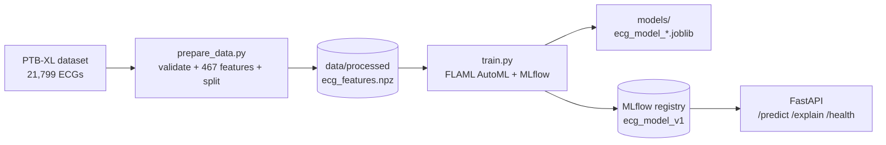

# ECG Anomaly Detection

**Classify 12-lead ECGs into five diagnostic classes (NORM, MI, STTC, CD, HYP) with an AutoML-tuned model that is tracked in MLflow and served through a validated FastAPI endpoint.**

Milestone 1: Model & API. Docker, CI/CD and deployment are Milestone 2.

## Architecture



## Quick start

```bash
git clone https://github.com/jawad1569/ECGAnomaly.git
cd ECGAnomaly
make setup                          # pip install -r requirements.txt
# download PTB-XL 1.0.3 from PhysioNet and unzip it into dataset/ (see below):
#   dataset/ptb-xl-a-large-publicly-available-electrocardiography-dataset-1.0.3/
make data                           # step 1: validate + build features
make train                          # step 2: AutoML + MLflow + save model
make test                           # pytest (13 tests; needs the trained model)
make dev                            # API on http://127.0.0.1:8000/docs (needs `make train` first)
mlflow ui --backend-store-uri sqlite:///mlflow.db   # inspect runs
```

`AUTOML_TIME_BUDGET=<seconds>` controls the AutoML search time (default 240).

Try the running API with a sample ECG (any CSV with `channel-0 ... channel-11` columns works):

```bash
python scripts/predict_sample.py samples/sample_upload_TEST_PATIENT.csv
```

Windows without `make`: `python manage.py data`, `python manage.py train`, `python manage.py test`, `python manage.py dev`.

## Dataset and task

- **Dataset:** [PTB-XL 1.0.3](https://physionet.org/content/ptb-xl/1.0.3/) (PhysioNet): 21,799 clinical 12-lead ECGs, 10 s each, used at 100 Hz (1,000 samples per lead).
- **Task:** multi-class classification of the primary diagnostic superclass: `NORM` (normal), `MI` (myocardial infarction), `STTC` (ST/T change), `CD` (conduction disturbance), `HYP` (hypertrophy). The label is the superclass with the highest annotated likelihood. 21,388 ECGs have such a label.
- **Split:** official PTB-XL folds: folds 1-9 train (19,230 ECGs, cross-validated inside AutoML), **fold 10 held-out test (2,158 ECGs)**, which is only used for final evaluation.
- **Metric:** macro-F1 (classes are unequal: NORM 9,246 ... HYP 1,288); accuracy and F1 for normal-vs-abnormal are also reported.

## Pipeline

1. **Data preparation** ([`src/pipeline/prepare_data.py`](src/pipeline/prepare_data.py)), separate from training. Validation per ECG (`validate_signal` in [`src/utils/features.py`](src/utils/features.py)): shape `(time, 12)`, at least 100 samples, **no missing/NaN/inf values**, **amplitude within +/-50 mV**; records without a diagnostic label are dropped. A summary is written to `data/processed/validation_report.json` (this run: 411 unlabelled records dropped, 0 invalid signals, 21,388 used). Then 467 features per ECG: per-lead statistics, spectral band powers, heart rate and variability, median-beat shape, lead correlations.
2. **Training** ([`src/pipeline/train.py`](src/pipeline/train.py)) loads the prepared data, runs a FLAML AutoML search (LightGBM, XGBoost, ExtraTrees, RandomForest; 3-fold CV; macro-F1), evaluates the best model on the held-out fold, and **saves it to `models/ecg_model_<timestamp>_<estimator>.joblib`** (with a `*_metrics.json` next to it). It also registers it in the MLflow registry as `ecg_model_v1` if macro-F1 is at least the best registered.
3. **API** ([`src/api`](src/api)): `POST /predict`, `POST /explain` (per-lead importance by masking), `GET /health`, Swagger at `/docs`. Inputs are validated with Pydantic and `validate_signal` (HTTP 400 on bad input).

## MLflow experiments

Experiment `ECG_AutoML_Phase1`. Every training run creates one parent run (`automl_parent`, full AutoML search) and **four child runs** (`trial_lgbm`, `trial_xgboost`, `trial_extra_tree`, `trial_rf`), each logging its model choice, best hyper-parameters (`best_config`), time budget, accuracy and macro-F1 on the held-out fold.

| Run | Model | Macro-F1 | Accuracy |
|-----|-------|----------|----------|
| `trial_lgbm` | LightGBM | **0.627** | 71.3% |
| `trial_xgboost` | XGBoost | 0.613 | 70.3% |
| `trial_extra_tree` | ExtraTrees | 0.572 | 68.8% |
| `trial_rf` | RandomForest | 0.533 | 65.1% |
| `automl_parent` | best of all (LightGBM) | **0.633** | **72.4%** |

### Best run and why

**Best run: `automl_parent` (MLflow run `936d2b09`), LightGBM.** Held-out fold 10: accuracy 72.4%, macro-F1 0.633, F1 normal-vs-abnormal 0.854.

Justification: it has the highest macro-F1, our selection metric, because classes are unequal and accuracy alone would favour NORM. It beats every single-family trial (best: LightGBM 0.627 with a short budget) because the full search spends more time tuning the winning family. Gradient boosting (LightGBM, XGBoost) clearly beats the bagged trees on these features. Per-class F1: NORM 0.84, STTC 0.66, MI 0.64, CD 0.63, HYP 0.41. HYP is weakest because it has the fewest examples (1,288). For reference, the first version (108 basic statistics per lead, 1,000 ECGs) reached about 52% accuracy; the richer features, the full dataset and AutoML account for the improvement.

## Repository layout

```
src/pipeline/prepare_data.py   data validation + feature extraction
src/pipeline/train.py          AutoML training, evaluation, model saving, MLflow
src/utils/features.py          features + validate_signal
src/utils/model_loader.py      loads the registered model for the API
src/api/                       FastAPI app (/predict, /explain, /health)
scripts/predict_sample.py      send a sample ECG to the running API
samples/                       two example ECG CSVs (1,000 x 12)
manage.py, Makefile            task runners (data, train, dev, test, lint)
models/                        saved model artifacts (ecg_model_<timestamp>_<est>.joblib)
tests/                         13 pytest tests
docs/                          presentations
```

## Notes

- `dataset/`, `data/`, `mlruns/` and `mlflow.db` are not committed (size). `models/` is.
- The API loads the latest registered `ecg_model_v1` from MLflow; if none exists it trains one on startup.
- See [CONTRIBUTION.md](CONTRIBUTION.md), [AI_USAGE.md](AI_USAGE.md) and the [LICENSE](LICENSE).
