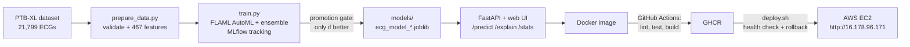

# ECG Anomaly Detection

[](https://github.com/jawad1569/ECGAnomaly/actions/workflows/ci.yml)

**Classify 12-lead ECGs into five diagnostic classes (NORM, MI, STTC, CD, HYP) with an AutoML-tuned, validated ensemble that is tracked in MLflow, served by FastAPI in Docker on AWS EC2, and only replaced when a retrained model is better.**

Milestone 1: model and API. Milestone 2: Docker, CI/CD, EC2 deployment, monitoring and a web UI.  
**Live:** http://16.178.96.171 (web UI) · [Project Focus](#project-focus) · [Getting started](#getting-started)

## Project Focus

**Focus: safe continuous model improvement (AutoML vs manual models, validated ensembling and a promotion gate),
with per-lead explainability as a second focus.**

- **What:** retraining is one command (`make train`). It runs a FLAML AutoML search, compares it with hand-picked
  models (HistGradientBoosting, logistic regression) and their soft-voting combinations, chooses on a validation fold,
  and only promotes a model that is at least as accurate and as balanced (macro-F1) as the one being served. Promoted
  models flow through CI into a new Docker image and are deployed with a health-checked script that can roll back.
  `/explain` shows which leads drove a prediction.
- **Why it suits this project:** an ECG triage model must keep improving without ever silently getting worse, and the
  classes are unequal (NORM 9,246 vs HYP 1,288), so accuracy alone can hide regressions on rare conditions. Clinicians
  also need to see why a recording was flagged.
- **What is built and compared:**
  - 4 AutoML model families (LightGBM, XGBoost, ExtraTrees, RandomForest) as MLflow child runs
  - AutoML winner vs manual models vs all their ensembles, selected on PTB-XL validation fold 9, scored once on test
    fold 10
  - promotion gate (accuracy AND macro-F1 not worse); rejected models are kept apart, superseded ones archived
  - per-lead importance by masking each lead (`/explain`), shown in the web UI
- **Results so far:** a longer AutoML search alone (1,200 s) scored 72.1% / 0.628 and was **rejected** by the gate; the
  validated ensemble scored **72.85% / 0.640** (was 72.43% / 0.633) and was **promoted** automatically. The web UI's
  model card shows the served model's accuracy and training date, so an update is visible immediately.
- **How it is demonstrated:** MLflow runs (`mlflow ui`), the training log with the gate decision, `/model` and the UI
  model card before and after a retrain, the rollback rehearsal in [RUNBOOK.md](RUNBOOK.md), and `/explain` in the UI.
- **Next steps (final presentation):** a GitHub Actions retraining workflow (manual or scheduled) that runs
  `train.py` and opens a pull request with the new model only if the gate passes; a data-drift check on incoming
  `/predict` features against the training distribution; per-class decision thresholds to lift HYP recall; and
  checking lead importance against cardiologist-annotated leads.

## Architecture



## Getting started

The fastest way to see the whole system: run it in Docker, make a prediction, watch the monitoring, then try the same
on the live deployment. You need Git and Docker; nothing else (no dataset, MLflow or training).

**1. Run the service** (one command, about a minute to build):

```bash
git clone https://github.com/jawad1569/ECGAnomaly.git && cd ECGAnomaly
docker build -t ecg-api . && docker run -d --name ecg-api -p 8000:8000 ecg-api
```

On Windows PowerShell 5.1, which has no `&&`, run the commands one by one.

**2. Check that it is healthy.** The container has a built-in healthcheck on `/health`; after about 10 s:

```bash
docker ps                          # STATUS: Up ... (healthy)
curl http://localhost:8000/health  # {"status":"healthy",...}
```

**3. Make a prediction**, whichever way you like:

- **Web UI:** open http://localhost:8000, click *Patient B · abnormal* (or drop any CSV from
  [`samples/test_ecgs/`](samples/test_ecgs)) and press *Analyze ECG*.
- **API docs:** open http://localhost:8000/docs, choose `POST /predict` → *Try it out*, paste the contents of
  [`samples/request_example.json`](samples/request_example.json) → *Execute*.
- **cURL:**

  ```bash
  curl -X POST http://localhost:8000/predict -H "Content-Type: application/json" -d @samples/request_example.json
  curl -X POST http://localhost:8000/explain -H "Content-Type: application/json" -d @samples/request_example.json
  ```

**4. Watch the monitoring.** Send a few requests, then look at the counters and the request log:

```bash
for i in 1 2 3 4 5; do curl -s -o /dev/null -X POST http://localhost:8000/predict -H "Content-Type: application/json" -d @samples/request_example.json; done
curl http://localhost:8000/stats   # request_count, avg_latency_ms, per-endpoint numbers
docker logs --tail 5 ecg-api       # one line per request
```

PowerShell: `1..5 | % { curl.exe -s -o NUL -X POST http://localhost:8000/predict -H "Content-Type: application/json" -d "@samples/request_example.json" }`

**5. Use the live deployment.** The same service runs on AWS EC2 (`ap-southeast-2`):

```bash
curl http://16.178.96.171/health
curl -X POST http://16.178.96.171/predict -H "Content-Type: application/json" -d @samples/request_example.json
curl http://16.178.96.171/stats
curl http://16.178.96.171/model    # served model: accuracy, macro-F1, training date
```

Or open http://16.178.96.171 in a browser. In PowerShell use `curl.exe` and `-d "@samples/request_example.json"`.

**6. Make a change and watch CI.** Every push runs lint → test → Docker build on GitHub Actions. For example, bump the
API version shown on `/docs` (`version="1.0.0"` in [`src/api/main.py`](src/api/main.py)) on a branch:

```bash
git switch -c chore/my-change
git commit -am "chore: bump API version to 2.0.0"
git push -u origin chore/my-change
```

A new run appears on the [Actions tab](https://github.com/jawad1569/ECGAnomaly/actions) within seconds. A failing
test turns it red and skips the build; open a pull request to `main` once it is green. After merging, CI publishes
`ghcr.io/jawad1569/ecganomaly:<short-sha>`, and `~/deploy.sh <short-sha>` on the server deploys it with a health check
and automatic rollback ([RUNBOOK.md](RUNBOOK.md)).

**7. Retrain the model** (needs the PTB-XL dataset, see [Development setup](#development-setup)). `make train`
searches, validates and only promotes a model that beats the served one; the web UI's model card and `/model` then show
the new accuracy and date.

**Stop the local container:** `docker rm -f ecg-api`.

## Development setup

```bash
git clone https://github.com/jawad1569/ECGAnomaly.git
cd ECGAnomaly
make setup     # install dependencies (requirements-dev.txt; the API alone needs requirements.txt)
# download PTB-XL 1.0.3 (PhysioNet) and unzip it into dataset/
make data      # step 1: validate + build features
make train     # step 2: AutoML + MLflow + save model
make test      # pytest, 27 tests (uses the committed model in models/)
make dev       # API at http://127.0.0.1:8000/docs (run make train first)
mlflow ui --backend-store-uri sqlite:///mlflow.db   # inspect runs
```

Expected folder: `dataset/ptb-xl-a-large-publicly-available-electrocardiography-dataset-1.0.3/`. `AUTOML_TIME_BUDGET=<seconds>` controls the AutoML search time (default 240).

Try the running API with a sample ECG (any CSV with `channel-0 ... channel-11` columns works):

```bash
python scripts/predict_sample.py samples/sample_upload_TEST_PATIENT.csv
```

Windows without `make`: `python manage.py data`, `python manage.py train`, `python manage.py test`, `python manage.py dev`.

## Run with Docker

The image serves the committed model in `models/` (no dataset, MLflow or training needed):

```bash
docker build -t ecg-api . && docker run -d --name ecg-api -p 8000:8000 ecg-api
```

Then open **http://localhost:8000** for the web UI (API docs at `/docs`). `docker ps` shows `(healthy)` once the built-in healthcheck on `/health` passes (about 10 s). The same with make: `make docker-build docker-run`, stop with `make docker-stop` (or `python manage.py docker-build` / `docker-run` / `docker-stop`).

```bash
curl http://localhost:8000/health
python scripts/predict_sample.py samples/sample_upload_TEST_PATIENT.csv   # /predict with a real ECG
```

The [Dockerfile](Dockerfile) uses `python:3.11-slim`, installs only the API runtime (`requirements.txt`), copies `src/` and `models/`, runs as a non-root user on port 8000 and sets `MODEL_SOURCE=file`, `AUTO_TRAIN=false`.

## Web UI

Open the service root (**http://16.178.96.171** live, http://localhost:8000 locally). The page is served by the API itself
([`src/api/static/`](src/api/static)): plain HTML, CSS and JavaScript, no build step and no extra container.

- **Model card:** held-out accuracy, macro-F1, F1 normal vs abnormal and the date the served model was last trained,
  from `GET /model` (read from the `*_metrics.json` that `train.py` saves next to each model).
- **Input: one ECG per file.** Drop a CSV (`channel-0 … channel-11` or `I … V6` columns, one row per sample) or pick
  Patient A (normal) / Patient B (abnormal). Files with several `ecg_id`s, more than 6,000 rows or several dropped files
  are rejected. The 12 leads are drawn on ECG paper (25 mm/s); click a lead to enlarge it.
- **Analyze:** sends the signal to `/predict` and `/explain`, then shows the diagnosis, class probabilities, per-lead
  importance (the three most important leads are marked on the plot) and the explanation. If the CSV has a `label`
  column, the page says whether the prediction matches it.
- **Monitoring:** a live panel polls `/stats` every 5 s (request count, average latency, errors, per-endpoint table).

The UI's static files are not counted in `/stats`. The previous JSON root moved to `GET /info`.

### Test ECGs

[`samples/test_ecgs/`](samples/test_ecgs) holds 10 real ECGs (2 per class) from PTB-XL's **held-out test fold**, so the
model never saw them in training. Each file is a single 10 s recording with its cardiologist `label`; drop any of them
on the UI. [`index.csv`](samples/test_ecgs/index.csv) lists the model's prediction for each: 5 of 10 are correct on this
random draw (the model is 72.9% accurate on the full fold; HYP is its weakest class). Regenerate or draw more with:

```bash
python scripts/make_test_samples.py --per-class 2 --seed 42   # needs the PTB-XL dataset in dataset/
```

## Monitoring

Every request is timed by a middleware ([`src/api/monitoring.py`](src/api/monitoring.py)):

- **`GET /stats`** (alias `/metrics`): request count, average latency, 4xx/5xx counts, uptime, model version, and the same per endpoint. Calls to `/stats` itself are not counted. Counters are in memory and reset on restart.
- **Logs**: one line per request, visible with `docker logs ecg-api`:
  `INFO request method=POST path=/predict status=200 latency_ms=408.9`
- **`GET /health`**: liveness, used by the Docker healthcheck.

```bash
curl http://localhost:8000/stats
# {"request_count": 4, "avg_latency_ms": 309.12, "client_errors_4xx": 0, "server_errors_5xx": 0,
#  "uptime_s": 14.1, "model_version": "ecg_model_20261125_202220_ensemble",
#  "per_endpoint": {"GET /health": {...}, "POST /predict": {"count": 3, "avg_latency_ms": 411.0, ...}}}
```

## CI

[`.github/workflows/ci.yml`](.github/workflows/ci.yml) runs on every push and on pull requests to `main`:

1. **lint**: `ruff check .` (rules in [`ruff.toml`](ruff.toml))
2. **test**: `pytest` on Python 3.11 against the committed model (`MODEL_SOURCE=file`)
3. **build** (after lint and test pass): builds the Docker image and checks that the container becomes `healthy` and answers `/health` and `/stats`. On `main` and on `v*` tags the image is pushed to `ghcr.io/jawad1569/ecganomaly`, tagged with the short commit SHA, plus `latest` (main) or the version tag.

## Deployment

The container runs on one **AWS EC2** `t3.micro` (Ubuntu 24.04, Docker) in `ap-southeast-2` on port 80, behind an Elastic IP.

**Live endpoint:** web UI http://16.178.96.171 · docs: http://16.178.96.171/docs · stats: http://16.178.96.171/stats (AWS `ap-southeast-2`, Sydney; deployed 2026-11-25)

Steps (details in [DEPLOYMENT.md](DEPLOYMENT.md)):

```powershell
powershell -ExecutionPolicy Bypass -File deploy\aws_create_ec2.ps1 -Profile ecg-project   # key pair, security group, instance, Elastic IP
powershell -ExecutionPolicy Bypass -File deploy\ship_image.ps1       # build, copy and deploy the image
# or, once CI has pushed to GHCR, on the server:  ~/deploy.sh <short-sha>
```

`deploy/deploy.sh` only keeps a new version if its container becomes healthy, otherwise it restarts the previous image. Redeploy and rollback by image tag: [RUNBOOK.md](RUNBOOK.md).

Example requests against the deployed service:

```bash
curl http://16.178.96.171/health
curl -X POST http://16.178.96.171/predict -H "Content-Type: application/json" -d @samples/request_example.json
curl -X POST http://16.178.96.171/explain -H "Content-Type: application/json" -d @samples/request_example.json
curl http://16.178.96.171/stats
python scripts/predict_sample.py samples/sample_upload_TEST_PATIENT.csv http://16.178.96.171
```

`samples/request_example.json` is a real 10 s, 12-lead ECG (1,000 × 12) from `samples/sample_upload_TEST_PATIENT.csv`; the expected answer is `"prediction": "NORM"`.

## Dataset and task

- **Dataset:** [PTB-XL 1.0.3](https://physionet.org/content/ptb-xl/1.0.3/) (PhysioNet): 21,799 clinical 12-lead ECGs, 10 s each, used at 100 Hz (1,000 samples per lead).
- **Task:** multi-class classification of the primary diagnostic superclass: `NORM` (normal), `MI` (myocardial infarction), `STTC` (ST/T change), `CD` (conduction disturbance), `HYP` (hypertrophy). The label is the superclass with the highest annotated likelihood. 21,388 ECGs have such a label.
- **Split:** official PTB-XL folds: folds 1-9 train (19,230 ECGs, cross-validated inside AutoML), **fold 10 held-out test (2,158 ECGs)**, which is only used for final evaluation.
- **Metric:** macro-F1 (classes are unequal: NORM 9,246 ... HYP 1,288); accuracy and F1 for normal-vs-abnormal are also reported.

## Pipeline

1. **Data preparation** ([`src/pipeline/prepare_data.py`](src/pipeline/prepare_data.py)), separate from training. Validation per ECG (`validate_signal` in [`src/utils/features.py`](src/utils/features.py)): shape `(time, 12)`, at least 100 samples, **no missing/NaN/inf values**, **amplitude within +/-50 mV**; records without a diagnostic label are dropped. A summary is written to `data/processed/validation_report.json` (this run: 411 unlabelled records dropped, 0 invalid signals, 21,388 used). Then 467 features per ECG: per-lead statistics, spectral band powers, heart rate and variability, median-beat shape, lead correlations.
2. **Training** ([`src/pipeline/train.py`](src/pipeline/train.py)) loads the prepared data, runs a FLAML AutoML search (LightGBM, XGBoost, ExtraTrees, RandomForest; 3-fold CV; macro-F1), then picks the best soft-voting combination of {AutoML model, HistGradientBoosting, logistic regression} on the PTB-XL **validation fold 9** and refits it on folds 1-9. It scores the final model once on the held-out fold 10 and saves it as `models/ecg_model_<timestamp>_<tag>.joblib` (with a `*_metrics.json` next to it). **Promotion gate:** the new model replaces the served one (and is registered as `ecg_model_v1` in MLflow) only if its accuracy and macro-F1 are both at least the served model's; otherwise it goes to `models/rejected/`. The superseded model moves to `models/archive/`.
3. **API** ([`src/api`](src/api)): `POST /predict`, `POST /explain` (per-lead importance by masking), `GET /health`, `GET /stats` (request count and latency), `GET /model` (held-out metrics and training date), Swagger at `/docs`, and a web UI at `/` (see below). Inputs are validated with Pydantic and `validate_signal` (HTTP 400 on bad input).

## MLflow experiments

Experiment `ECG_AutoML_Phase1` (`mlflow ui --backend-store-uri sqlite:///mlflow.db`). Every training run creates a parent
run (`automl_parent`), **four child runs** for the AutoML trials (`trial_lgbm`, `trial_xgboost`, `trial_extra_tree`,
`trial_rf`: model choice, best hyper-parameters, time budget, accuracy and macro-F1) and an `ensemble_selection` run
(candidates, chosen combination, fold-9 validation scores).

### Milestone 2 retraining (current model, 25 Nov 2026)

Run `2d96a8b3` (`AUTOML_TIME_BUDGET=300`, about 12 minutes). Ensemble chosen on validation fold 9, scored once on fold 10:

| Run / candidate | Model | Fold-9 accuracy | Fold-10 macro-F1 | Fold-10 accuracy |
|-----|-------|-----------------|------------------|------------------|
| `trial_lgbm` | LightGBM | | 0.633 | 72.4% |
| `trial_xgboost` | XGBoost | | 0.633 | 71.6% |
| `trial_extra_tree` | ExtraTrees | | 0.578 | 68.8% |
| `trial_rf` | RandomForest | | 0.576 | 68.8% |
| ensemble candidate | LightGBM alone | 73.2% | | |
| ensemble candidate | HistGradientBoosting alone | 73.7% | | |
| **`automl_parent`** | **LightGBM + HistGB + LogReg (soft vote)** | **74.0%** | **0.640** | **72.9%** |
| previous served model | LightGBM (run `936d2b09`, 6 Nov) | | 0.633 | 72.4% |

**Best run: `automl_parent` `2d96a8b3`, soft-voting ensemble.** Held-out fold 10: accuracy **72.85%**, macro-F1
**0.640**, F1 normal-vs-abnormal **0.856** (previous model: 72.43%, 0.633, 0.854). Per-class F1: NORM 0.84, STTC 0.66,
CD 0.64, MI 0.63, HYP 0.43.

Why this model: averaging the probabilities of three different model types (boosted trees with leaf-wise and
histogram-based growth, plus a linear model) reduces the errors any single model makes, and it was the best
combination on the validation fold. The test fold played no part in choosing it, so the gain is not tuned to the test
set. It passed the promotion gate on both accuracy and macro-F1, so it replaced the previous model automatically.
A longer AutoML search alone did not help: a 1,200 s run found a LightGBM with 72.1% / 0.628, which the gate kept out.

### Milestone 1 baseline (6 Nov 2026)

Run `936d2b09`, LightGBM from a 240 s AutoML search: accuracy 72.4%, macro-F1 0.633, F1 normal-vs-abnormal 0.854.
Single-family trials: LightGBM 0.627, XGBoost 0.613, ExtraTrees 0.572, RandomForest 0.533 macro-F1. Gradient boosting
clearly beats bagged trees on these features; HYP is the weakest class because it has the fewest examples (1,288).

## Repository layout

```
src/pipeline/prepare_data.py   data validation + feature extraction
src/pipeline/train.py          AutoML + validated ensemble, evaluation, promotion gate, MLflow
src/utils/features.py          features + validate_signal
src/utils/model_loader.py      loads the served model for the API
src/utils/ensemble.py          soft-voting ensemble used by the current model
src/api/                       FastAPI app (/predict, /explain, /health, /stats)
src/api/static/                web UI (HTML/CSS/JS, served at /) + two sample ECGs
scripts/predict_sample.py      send a sample ECG to the running API
samples/                       example ECG CSVs (1,000 x 12); test_ecgs/ = labelled held-out test ECGs
manage.py, Makefile            task runners (data, train, dev, test, lint, docker-*)
Dockerfile, .dockerignore      API container image
deploy/                        EC2 create/destroy, server setup, deploy + rollback scripts
DEPLOYMENT.md, RUNBOOK.md      deployment steps; redeploy and rollback procedures
models/                        saved model artifacts (ecg_model_<timestamp>_<est>.joblib)
tests/                         27 pytest tests
ruff.toml                      lint rules (ruff check .)
.github/workflows/ci.yml       CI: lint, test, Docker build + push to GHCR
docs/                          presentations
```

## Notes

- `dataset/`, `data/`, `mlruns/` and `mlflow.db` are not committed (size). `models/` is.
- The API loads the model set by `MODEL_SOURCE`: `auto` (default) tries the latest registered `ecg_model_v1` in MLflow, then the newest committed `models/ecg_model_*.joblib`; `file` skips MLflow (used in Docker and CI, where there is no `mlflow.db`). Training on startup when no model exists is opt-in with `AUTO_TRAIN=true`.
- See [CONTRIBUTION.md](CONTRIBUTION.md), [AI_USAGE.md](AI_USAGE.md) and the [LICENSE](LICENSE).
